# Landing Page on Astro

Базовый MVP для продажи авторских 3D-фигурок кавалер-кинг-чарльз-спаниелей (ККЧС) и сбора заявок на изготовление. Проект построен на гибридной архитектуре: сверхбыстрый фронтенд на [Astro](https://github.com/withastro/astro) с минимальным клиентским JavaScript и лёгкий REST API на нативном PHP + MySQL для приёма лидов.

Результат на [Behance](https://www.behance.net/gallery/258960197/kkchsStore-MVP-lendinga-masterskoj-3D-figurok).

- [Landing Page on Astro](#landing-page-on-astro)
  - [Что в проекте](#что-в-проекте)
  - [Запуск и развёртывание проекта](#запуск-и-развёртывание-проекта)
    - [1. Требования к окружению](#1-требования-к-окружению)
    - [2. Клонирование и установка зависимостей](#2-клонирование-и-установка-зависимостей)
    - [3. Настройка переменных окружения](#3-настройка-переменных-окружения)
    - [4. Настройка базы данных и бэкенда (опционально)](#4-настройка-базы-данных-и-бэкенда-опционально)
    - [5. Локальный запуск](#5-локальный-запуск)
    - [6. Замена медиа-заглушек на реальные файлы](#6-замена-медиа-заглушек-на-реальные-файлы)
    - [7. Сборка для продакшена](#7-сборка-для-продакшена)
    - [Защита от спама и флуда](#защита-от-спама-и-флуда)
    - [Отправка сообщения в Telegram через Bot API](#отправка-сообщения-в-telegram-через-bot-api)
  - [Чек-лист замены домена в проекте](#чек-лист-замены-домена-в-проекте)
  - [Воронка событий](#воронка-событий)

## Что в проекте

- **Astro** — лэйауты → страницы → компоненты
- **SCSS** — модульная архитектура стилей
- **JSON** — структурированное хранилище контента, мета-тегов и фолбэк-каталога с подгрузкой актуальных цен из БД

```mermaid
flowchart TB
    root["📁 Корень проекта"] --> api["📁 api/"]
    root --> docs["📁 docs/"]
    root --> public["📁 public/ (статические ассеты и SEO-файлы)"]
    root --> src["📁 src/"]

    subgraph API ["Backend (PHP + MySQL)"]
        direction TB
        api --> v1["📁 v1/"]
        v1 --> cfg["config.php — БД и ключи Telegram"]

        api --> v2["📁 v2/"]
        v2 --> hta[".htaccess — правила REST API"]
        v2 --> idx_php["index.php — роутер и CORS"]
        v2 --> ckcs["📁 ckcs/"]
        ckcs --> fig_php["ckcs-figures.php — GET каталог и цены"]
        ckcs --> lead_php["ckcs-leads.php — POST лиды, антиспам, TG"]
    end

    docs --> db_md["db.md — SQL-схемы таблиц"]

    subgraph FRONT ["Frontend (Astro + SCSS)"]
        direction TB
        src --> layout["📁 layouts/ → Layout.astro"]
        src --> page["📁 pages/ → index.astro"]
        src --> data["📁 data/ → landing.json"]
        src --> plug["📁 plugins/ → llms.txt.mjs (генератор AEO/GEO)"]
        src --> comp["📁 components/"]
        src --> styles["📁 styles/"]

        subgraph COMP ["Компоненты (.astro)"]
            direction TB
            comp --> c_head["Header (мобильный drawer) · Hero · Footer"]
            comp --> c_info["AboutCavaliers · Process · Faq"]
            comp --> c_shop["Catalog · ProductCard · Testimonials · Order"]
            comp --> c_sys["Analytics (YM / GTM) · CookieBanner (152-ФЗ)"]
        end

        subgraph SCSS ["Модульные стили (.scss)"]
            direction TB
            styles --> s_glob["global.scss — единая точка сборки"]
            styles --> s_util["utils/_variables.scss — цвета, шрифты, брейкпоинты"]
            styles --> s_comp["components/ (_product-card, _cookie-banner)"]
            styles --> s_sec["sections/ (_header, _hero, _cavaliers, _process, _catalog, _testimonials, _faq, _order, _footer)"]
        end
    end
```



<details>
<summary>Структура</summary>

```js
├── api/
│   ├── v1/
│   │   └── config.php                  // конфигурация подключения к БД и секретные ключи Telegram
│   │
│   └── v2/
│       ├── ckcs/
│       │   ├── ckcs-figures.php        // GET-эндпоинт для получения активного каталога и цен из БД
│       │   └── ckcs-leads.php          // POST-эндпоинт: антиспам, валидация, запись в БД и отправка в TG
│       ├── .htaccess                   // правила маршрутизации Apache (mod_rewrite) для REST API
│       └── index.php                   // фронт-контроллер API (CORS, роутинг запросов)
│
├── docs/
│   └── db.md                           // SQL-схемы таблиц и инструкция по развёртыванию БД
│
├── public/                             // статические ассеты, копируемые в корень сборки без изменений
│   ├── favicon.svg                     // фавиконка сайта
│   ├── llms.txt                        // файл для ИИ-поисковиков (генерируется автоматически)
│   ├── robots.txt                      // правила индексации для поисковых роботов
│   └── sitemap.xml                     // карта сайта для поисковиков
│
└── src/
    ├── components/
    │   ├── AboutCavaliers.astro        // секция про породу кавалер-кинг-чарльз-спаниелей и качество печати
    │   ├── Analytics.astro             // подключение Яндекс Метрики, GTM и единого хелпера trackEvent
    │   ├── Catalog.astro               // слайдер карточек (свайп + кнопки), трекинг выбора и подгрузка цен из БД
    │   ├── CookieBanner.astro          // уведомление об использовании cookie и Яндекс Метрики (152-ФЗ)
    │   ├── Faq.astro                   // аккордеон с частыми вопросами на нативном <details>
    │   ├── Footer.astro                // подвал сайта
    │   ├── Header.astro                // парящая шапка с логотипом, навигацией и мобильным меню
    │   ├── Hero.astro                  // первый экран с УТП, видеофоном и стеклянной плашкой статистики
    │   ├── Order.astro                 // форма заказа с живым превью фигурки, honeypot, чекбоксом 152-ФЗ и трекингом
    │   ├── Process.astro               // пошаговый процесс изготовления фигурки (Bento-сетка 2×2)
    │   ├── ProductCard.astro           // бутиковая карточка фигурки с пастельной подложкой
    │   └── Testimonials.astro          // блок с отзывами покупателей
    |
    ├── data/
    │   └── landing.json                // базовый контент, мета-теги, FAQ, отзывы и фолбэк-каталог
    |
    ├── layouts/
    │   └── Layout.astro                // основной HTML-шаблон (head, шрифты Unbounded + Golos Text, аналитика)
    |
    ├── pages/
    │   └── index.astro                 // точка сборки главной страницы лендинга
    |
    ├── plugins/
    │   └── llms.txt.mjs                // генератор llms.txt для AEO/GEO-оптимизации
    |
    └── styles/
        ├── components/
        │   ├── _cookie-banner.scss     // стили плавающего cookie-баннера
        │   └── _product-card.scss      // стили карточки фигурки (для статики и динамического рендера)
        |
        ├── sections/
        │   ├── _catalog.scss           // стили слайдера каталога и кнопок навигации
        │   ├── _cavaliers.scss         // стили блока о породе и карточек преимуществ
        │   ├── _faq.scss               // стили аккордеона вопросов-ответов
        │   ├── _footer.scss            // стили подвала
        │   ├── _header.scss            // стили парящей шапки и мобильного drawer-меню
        │   ├── _hero.scss              // стили первого экрана
        │   ├── _order.scss             // стили формы заказа, живого превью, чекбокса ПДн и honeypot-поля
        │   ├── _process.scss           // стили карточек этапов производства (сетка 2×2)
        │   └── _testimonials.scss      // стили карточек отзывов
        |
        ├── utils/
        │   └── _variables.scss         // SCSS-переменные цветов, шрифтов, теней и миксины адаптивности
        |
        └── main.scss                   // сброс стилей, базовые классы и единая точка импорта SCSS
```
</details>

## Запуск и развёртывание проекта

Проект можно запустить в **демо-режиме (только фронтенд)** — в этом случае каталог и тексты подтянутся из локального `src/data/landing.json`, — либо в **полном режиме** с подключением PHP API, MySQL и уведомлений в Telegram.

### 1. Требования к окружению
* **Node.js** `v20+` (рекомендуется `v22+`) и `npm`
* **PHP** `8.0+` с расширениями `pdo_mysql`, `curl`, `mbstring` и включённым `mod_rewrite` (для Apache)
* **MySQL** `5.7+` / **MariaDB** `10.3+`

### 2. Клонирование и установка зависимостей

```bash
git clone https://github.com/madeas/landing-astro-ckcs
cd landing-astro-ckcs
npm install
```

### 3. Настройка переменных окружения
Создайте в корне проекта файл `.env` для локальной разработки:

```bash
# Укажите URL вашего локального PHP-сервера или тестового стенда
PUBLIC_API_URL=http://domen.site/api/v2
```

*(Файл `.env.production` уже настроен на относительный путь `/api/v2` и применится автоматически при продакшн-сборке).*

### 4. Настройка базы данных и бэкенда (опционально)

1. Создайте базу данных выполните SQL-запросы из файла [`docs/db.md`](docs/db.md) для создания таблиц `ckcs_leads` и `ckcs_figures`.
2. Создайте файл `api/v1/config.php` со следующими параметрами:

```php
<?php
return [
    'host'       => 'localhost',
    'db'         => 'имя_базы_данных',
    'user'       => 'пользователь_бд',
    'pass'       => 'пароль_бд',
    'tg_token'   => '', // опционально: токен бота от @BotFather
    'tg_chat_id' => '', // опционально: ваш ID чата в Telegram
];
```

3. В файле `api/v2/index.php` при необходимости добавьте свой локальный домен/порт в массив `$allowedOrigins`.
4. Если вам не нужны данные с сервера, просто закомментируйте вызов функции `loadDynamicFigures()` в файле `Catalog.astro`.

### 5. Локальный запуск

Запустите сервер разработки Astro (по умолчанию откроется на `http://localhost:8081`):

```bash
npm run dev
```

### 6. Замена медиа-заглушек на реальные файлы
* **Фоновое видео в Hero:** поместите оптимизированный `.mp4`-ролик в папку `public/video/hero.mp4` (рекомендуемый размер до 5–8 МБ).
* **Изображения:** замените ссылки `placehold.co` в `src/data/landing.json` (и в колонке `image_url` таблицы `ckcs_figures`) на пути к реальным фотографиям фигурок.

### 7. Сборка для продакшена

```bash
npm run build
```

Готовая статика соберётся в папку `dist/`. Для деплоя на хостинг (например, Reg.ru) загрузите содержимое `dist/` в корневую директорию домена, а папку `api/` разместите согласно вашей серверной структуре.

---

### Защита от спама и флуда

В форме заказа и обработчике `ckcs-leads.php` реализована трёхуровневая защита без капчи:
- **Honeypot** — скрытое поле `website` (боты заполняют его автоматически и получают фейковый `ok` без записи в БД).
- **Time-trap** — блокировка мгновенной отправки быстрее 2 секунд с момента открытия страницы.
- **Rate-limiting по IP** — не более 3 заявок с одного IP-адреса за 10 минут.

### Отправка сообщения в Telegram через Bot API

Создаём бота и узнаём свой `chat_id`:

1. Откройте в Telegram официального бота **@BotFather**, отправьте команду `/newbot`, придумайте имя (например, `Заявки ККЧС`) и юзернейм с окончанием `bot` (например, `ckcs_leads_bot`).
2. Скопируйте токен (`tg_token`) вида `1234567890:AAF1b2c3d4e5f6g7h8i9j0...`.
3. Найдите своего нового бота в поиске Telegram, откройте его и нажмите **Запустить** (`/start`), так как бот не может написать вам первым, пока вы не откроете с ним диалог.
4. Узнайте свой числовой ID аккаунта (`tg_chat_id`) через любого служебного бота (например, **@userinfobot** или **@getmyid_bot** — просто нажмите `/start`, он пришлёт ваш `Id`, например `194827365`).
5. Добавьте полученные значения `tg_token` и `tg_chat_id` в конфигурационный файл `api/v1/config.php` на сервере.

**Что это даёт?** Мгновенное уведомление менеджера в Telegram о новой заявке с выбранной фигуркой и контактами клиента сразу после сохранения лида в MySQL.

## Чек-лист замены домена в проекте

В проекте используется рыбный домен `domen.site`. Перед публикацией на боевой сервер замените его на ваш реальный адрес (рекомендуется сразу с `https://`) в следующих файлах:

1. **`astro.config.mjs`** — параметр `site: 'https://domen.site'` (отсюда автоматически формируются `<link rel="canonical">`, `og:url`, микроразметка Schema.org и ссылка в генерируемом `public/llms.txt` при запуске `npm run build`).
2. **`public/robots.txt`** и **`public/sitemap.xml`** — адрес карты сайта (`Sitemap: https://domen.site`), тег `<loc>` и актуальная дата обновления `<lastmod>`.
3. **`.env`** *(только для локальной разработки)* — переменная `PUBLIC_API_URL=https://domen.site`, если тестируете локальный фронтенд с боевым PHP API (для продакшн-сборки в `.env.production` уже прописан относительный путь `/api/v2`).

*(Примечание: при статической сборке output: 'static' без указанного site в astro.config.mjs значение Astro.url.origin во время npm run build вернёт http://localhost:4321. Если хотите, чтобы в статическом HTML в canonical и og:url гарантированно подставлялся боевой домен, лучше оставить строку в Layout.astro в чек-листе или задать site в astro.config.mjs).*

## Воронка событий

Чтобы аналитика помогала, настройте отправку кастомных целей в ключевых точках:

1. Замените тестовые заглушки на реальные идентификаторы вашего счётчика и контейнера:

```env
PUBLIC_YM_ID=12345678
PUBLIC_GTM_ID=GTM-XXXXXXX
```
2. Создать цели в интерфейсе Яндекс.Метрики:
   - Метрика → Настройки → Цели → Добавить цель:
   - Выберите тип JS-событие (условие: совпадает)
   - Создайте три цели с точными идентификаторами:

| Название цели (для себя) | Тип цели   | Идентификатор цели     | Что передаётся в параметрах визита  |
| :----------------------- | :--------- | :--------------------- | :---------------------------------- |
| Выбор фигурки в каталоге | JS-событие | `click_catalog_select` | `figure` (название), `price` (цена) |
| Начал заполнять форму    | JS-событие | `form_start`           | —                                   |
| Отправка заявки (Лид)    | JS-событие | `lead_submit`          | `figure` (выбранная фигурка и цена) |
